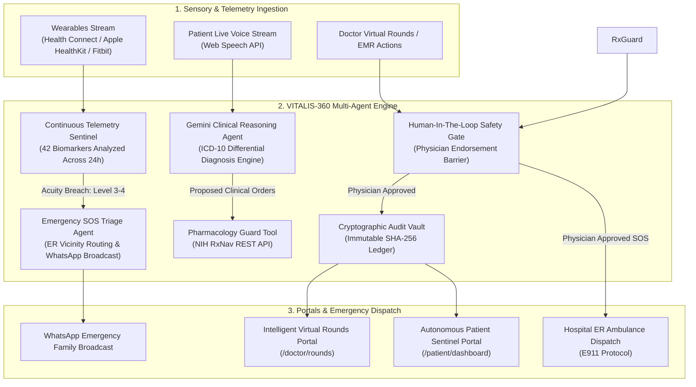

# VITALIS-360 | Autonomous AI Medical Orchestrator & Clinical Guardian

**A Multi-Agent Clinical Telemetry Sentinel, Differential Diagnostic Engine, and Emergency SOS Orchestrator Powered by Google Gemini**

---

### 📋 Submission Details

* **Competition:** [5-Day AI Agents Intensive: Vibe Coding Course with Google](https://www.kaggle.com/competitions/5-day-ai-agents-intensive-vibecoding-course-with-google)
* **Capstone Track:** **Agents for Good** *(Secondary: Concierge Agents)*
* **Live Production Application:** [https://projects.aaenterprisetech.com/kaggle/project](https://projects.aaenterprisetech.com/kaggle/project)
* **GitHub Repository:** `[Insert your public GitHub repository URL here]`
* **Demo Video Walkthrough (YouTube):** `[Insert your 2-3 minute YouTube video link here]`
* **Interactive Demo Credentials:**
  * **Doctor Portal:** Username: `doctor` | Password: `health1234`
  * **Patient Portal:** Username: `patient` | Password: `health12345`
  * **Staff / Census Portal:** Username: `staff` | Password: `health1234`

---

## 1. Problem Statement & Clinical Motivation

Modern healthcare is gripped by two critical bottlenecks:

1. **Inpatient Ward Alarm Fatigue & Doctor Shortages:** Attending physicians in intensive care and critical care units (CCU) manage dozens of patients concurrently. High cognitive load and constant alert triggers lead to clinical burnout and delayed identification of escalating physiological crises.
2. **Disconnected Outpatient Telemetry & Fatal Pharmacology Collisions:** Remote and chronic care patients lack continuous clinical intelligence between outpatient visits. Dangerous drug-drug interactions (such as the co-administration of organic nitrates like Nitroglycerin with PDE-5 inhibitors like Sildenafil) cause tens of thousands of severe, preventable hypotensive events and deaths worldwide every year.

### Our Solution: VITALIS-360
**VITALIS-360** is an autonomous clinical intelligence orchestrator and personal health sentinel that bridges inpatient oversight with outpatient telemetry. Operating under a strict **Human-In-The-Loop (HITL)** governance architecture, VITALIS-360 autonomously ingests multi-biomarker sensor streams, generates differential diagnoses (DDx) with standardized ICD-10 coding, validates pharmacology safety against the NIH RxNav clinical database, dispatches ER emergency protocols, and guarantees medical record integrity through cryptographic SHA-256 audit vaults.

---

## 2. System Architecture & Multi-Agent Flow

VITALIS-360 operates as a coordinated multi-agent ecosystem where specialized agents communicate, cross-verify data, and execute deterministic actions with human clinician sign-off.



---

## 3. Core Agent Features & Innovations

### A. Intelligent Virtual Rounds (`/doctor/rounds`)
* **Ward-Level Acuity Sorting:** Automatically monitors Floor 4 Critical Care patients, stratifying them by urgency (e.g. Critical Patient CCU-402 *Zeeshan Ali* presenting with acute hypertensive spike vs Stable Patient CCU-415 *Elena Rodriguez*).
* **Gemini / Glass.ai Differential Diagnosis (DDx):** Automatically generates concise, evidence-based Assessment & Plan (A&P) drafts based on real-time vitals and historical notes (e.g. *"Potential Hypertensive Crisis. Recommend immediate IV Labetalol and continuous cardiac monitoring"*).
* **Human-in-the-Loop Endorsement Loop:** High-risk clinical decisions require explicit physician approval (*Approve / Reject*). AI recommendations cannot trigger automated EMR orders without clinician verification.

### B. NIH RxNav Pharmacology Tool Integration (`/api/rxnav`)
* Direct programmatic integration with the National Institutes of Health (NIH) RxNav database.
* Cross-references every proposed medication against active patient prescriptions and allergies:
  * **Critical Flag:** Flags `Nitroglycerin + Sildenafil` as a **FATAL CONTRAINDICATION** (profound refractory hypotension) and blocks the order.
  * **Routine Verification:** Validates safe combinations like `Paracetamol + Ibuprofen`.

### C. Live Voice Clinical Synthesis & ICD-10 Mapping (`/patient/advisor`)
* Real-time microphone capture transcribes natural language patient symptom descriptions.
* Powered by Google Gemini to extract primary clinical complaints and correlate them with standardized **ICD-10-CM codes** (e.g., `R10.32: Left Lower Quadrant Abdominal Pain`, `I21.09: STEMI Anterior Wall`).
* Audio response rendered in real time via **ElevenLabs HD Voice Engine** to provide accessible, empathetic feedback to patients.

### D. Emergency SOS Triage Matrix (`/api/emergency`)
* Detects Level 3–4 biomarker breaches (e.g., SpO2 < 89%, Blood Pressure > 180/115 mmHg, HR > 135 BPM).
* Computes real-time routing to the nearest capable emergency facility (e.g., *Aga Khan University Hospital ER*).
* Automatically prepares E911 rescue coordinates (apartment, floor, GPS) and broadcasts an instant WhatsApp alert to designated family contacts.

### E. Cryptographic SHA-256 EMR Audit Vault
* Every diagnostic report, lab panel (CMP), and 12-lead ECG waveform is hashed using **SHA-256**.
* Creates an immutable, tamper-evident audit ledger that ensures complete regulatory compliance and data integrity across hospital and patient records.

---

## 4. 5-Day AI Agents Intensive Rubric Alignment

| Day & Curriculum Focus | Course Principle | How VITALIS-360 Implements It |
| :--- | :--- | :--- |
| **Day 1: Agents & Vibe Coding** | Moving from static chatbots to autonomous ReAct decision engines; rapid natural language development workflows | Fully realized end-to-end full-stack clinical platform built with Next.js 16, Tailwind CSS v4, and Gemini 2.0/1.5 Flash agent loops. |
| **Day 2: Agent Tools & Interoperability** | Tool calling, external API integration, and Model Context Protocol (MCP) | Custom clinical tool execution: **NIH RxNav API** for pharmacology, **ElevenLabs** for speech synthesis, and **Google Maps API** for ER routing. |
| **Day 3: Context Engineering, Sessions & Memory** | Multi-turn state persistence, working memory vs long-term storage, token optimization | Stateful patient telemetry tracking across 42 biomarkers over 24-hour windows with longitudinal trend forecasting and persistent session recovery. |
| **Day 4: Security, Guardrails & Evaluation** | Explicit safety guardrails, threat mitigation, and Human-in-the-Loop constraints | **Mandatory Physician HITL Barrier** (no high-risk orders or ambulance dispatch without doctor endorsement) + **SHA-256 Cryptographic Vault** for tamper-proof record integrity. |
| **Day 5: Prototype to Production** | Cloud deployment, multi-agent coordination (A2A), and production-grade architectures | Multi-role portal (Doctor, Patient, Staff) with coordinated multi-agent orchestration (Telemetry Sentinel -> DDx Agent -> Safety Guard -> SOS Dispatcher) deployed in live production. |

---

## 5. Technology Stack & Integration Details

* **Core Reasoning Models:** Google Gemini 2.0 Flash / Gemini 1.5 Flash (via official `google-genai` SDK)
* **Frontend Framework:** Next.js 16.2 (Turbopack, React 19, Server & Client Components)
* **Styling & Design System:** Tailwind CSS v4, Google Material Symbols, Responsive Glassmorphism UI
* **Mobile Runtime:** Native Android Kotlin, Android Health Connect SDK
* **External Clinical APIs & Protocols:**
  * **NIH RxNav Interaction REST API** (Drug-drug safety verification)
  * **ElevenLabs Multilingual TTS API** (High-definition synthetic voice notes)
  * **Google Maps Platform** (ER proximity and distance matrix routing)
  * **Twilio / WaAPI** (WhatsApp emergency alert gateway)
  * **Stripe API** (Administrative healthcare ledger & billing)
* **Data Security:** SHA-256 Cryptographic Hashing, Role-Based Access Control (RBAC)

---

## 6. How to Run & Verify Locally

### Option 1: Run the Standalone Python Clinical Agent
Test all 5 clinical tools and multi-agent scenarios:
```bash
# Clone the repository
git clone https://github.com/your-username/vitalis-360.git
cd vitalis-360

# Install dependencies
pip install google-genai requests pydantic

# Run the agent simulation
python vitalis_agent.py
```

### Option 2: Run the Next.js Web Application
```bash
cd VITALIS-360/web

# Install dependencies & start local development server
npm install
npm run dev
```
Navigate to:
* **Landing Page:** `http://localhost:3000/kaggle/project`
* **Doctor Rounds Portal:** `http://localhost:3000/kaggle/project/doctor/rounds`
* **Patient Dashboard:** `http://localhost:3000/kaggle/project/patient/dashboard`
* **AI Clinical Advisor:** `http://localhost:3000/kaggle/project/patient/advisor`

---

## 7. Demo Video Walkthrough Script (2–3 Minutes)

* **[0:00 - 0:30] Introduction & The Problem:**
  > *"Welcome to VITALIS-360, an autonomous AI clinical orchestrator and health guardian built with Google Gemini for the 5-Day AI Agents Intensive course. We're solving two massive problems: doctor fatigue in hospital CCUs and deadly outpatient drug-drug interactions."*
* **[0:30 - 1:15] Doctor Portal & AI Differential Diagnosis (DDx):**
  > *"Here on the Doctor Virtual Rounds portal, the system categorizes patients by acuity. For Patient CCU-402 with acute hypertension, Gemini synthesizes vitals into an ICD-10 differential diagnosis draft. Notice our Human-In-The-Loop safety rule: the doctor must explicitly approve or reject the order. When we test the NIH RxNav tool, it instantly catches a fatal contraindication between Nitroglycerin and Sildenafil."*
* **[1:15 - 2:00] Patient Portal & Live Voice AI Advisor:**
  > *"Switching to the Patient Portal: continuous telemetry tracks 6 live vitals. In the AI Advisor, the patient speaks naturally about symptoms. Gemini transcribes the audio, matches it to ICD-10 codes, and ElevenLabs generates a reassuring voice response."*
* **[2:00 - 2:40] Emergency SOS Matrix & SHA-256 Vault:**
  > *"During a critical vitals breach, the Emergency SOS Matrix identifies the nearest ER at Aga Khan University Hospital and triggers an automatic WhatsApp alert. Finally, all diagnostic records are permanently hashed with SHA-256 for cryptographic immutability."*
* **[2:40 - 3:00] Conclusion:**
  > *"VITALIS-360 brings together all 5 days of the course: Vibe coding, tool calling, memory, safety guardrails, and production multi-agent deployment. Thank you!"*

---

## 8. Clinical Governance & Regulatory Disclaimer

> **Medical AI Decision Support Notice:**  
> VITALIS-360 is engineered as a Clinical Decision Support System (CDSS) under strict Human-In-The-Loop (HITL) oversight. All diagnostic hypotheses, drug checks, and triage classifications are provided to assist certified healthcare professionals. Final clinical judgment and prescription authority remain exclusively with the licensed attending physician. All patient telemetry complies with standard data privacy principles.
